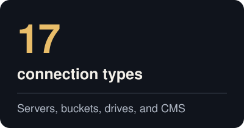
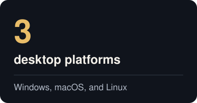
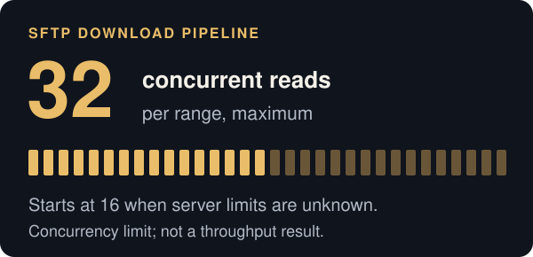
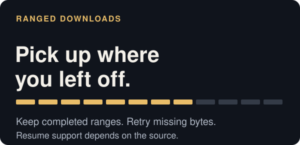
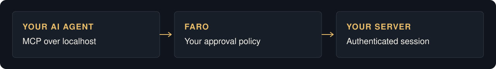

<p align="center">
  
</p>

<h1 align="center">Faro</h1>

<p align="center"><strong>File &amp; Agent Remote Operations</strong></p>

<p align="center"><strong>A modern desktop client for SFTP, FTP, SSH, S3-compatible storage, WebDAV, and cloud storage.</strong></p>

<p align="center">
  <a href="https://github.com/jhd3197/faro/releases/latest"></a>
  <a href="https://github.com/jhd3197/faro/releases"></a>
  <a href="LICENSE"></a>
  <a href="https://discord.gg/ZKk6tkCQfG"></a>
</p>

<p align="center">
  <strong><a href="https://github.com/jhd3197/faro/releases/latest">Download Faro</a></strong> ·
  <a href="https://www.youtube.com/watch?v=nL9r3c9-5Kc">Watch the demo</a> ·
  <a href="#screenshots">Take a tour</a> ·
  <a href="#transfers">Transfers</a> ·
  <a href="#agent-bridge">Agent Bridge</a> ·
  <a href="#develop">Build from source</a>
</p>

<p align="center">
  English · <a href="docs/README.es.md">Español</a> · <a href="docs/README.zh-CN.md">中文版</a> · <a href="docs/README.pt.md">Português</a>
</p>

**Faro is a desktop file client for Windows, macOS, and Linux.** Connect to a server or cloud account, browse files side by side, and transfer folders between them. Open an SSH terminal in the same workspace, edit remote files with your own editor, or give a local AI agent access through the Agent Bridge.

<p align="center">
  <a href="#backends"></a>
  <a href="#quick-start"></a>
  <a href="#cli"></a>
</p>

<a name="-quick-start"></a>
## Quick start

Choose an installer from the [latest release](https://github.com/jhd3197/faro/releases/latest).

| Platform | Downloads |
|---|---|
| **Windows · x64** | `.exe` installer, `.msi`, or portable `.zip` |
| **macOS · Intel + Apple Silicon** | Universal `.dmg` |
| **Linux · x64** | `.AppImage`, `.deb`, or `.rpm` |

Open **New Connection**, choose your backend, and enter its connection details. You can also import profiles from `~/.ssh/config`, FileZilla, or PuTTY.

<details>
<summary><strong>First launch: unsigned builds on Windows and macOS</strong></summary>

Faro's desktop builds do not yet have an Apple notarization or Windows code-signing certificate.

- **Windows:** on the “Windows protected your PC” prompt, select **More info → Run anyway**.
- **macOS:** drag Faro to Applications, then run the following once if macOS reports it as damaged:

  ```bash
  xattr -cr /Applications/Faro.app
  ```

- **Linux AppImage:** make the downloaded file executable with `chmod +x <filename>.AppImage`.

</details>

<!-- FARO:SHOTS:START -->
<a name="-screenshots"></a>
## Screenshots

### Your local files and remote files, side by side

Keep servers in the connection rail, drag files between panes, and save frequently used folders as site shortcuts.


<sub>App screenshots use fictional demo data, including hostnames, paths, and transfer speeds. [Reproduce the screenshots](docs/screenshots/CAPTURE.md).</sub>

| Open a terminal where you work | See what is taking up space |
|---|---|
|  |  |
| Use an SSH shell alongside the file browser. | Explore a folder with a treemap and size-ranked tree. |

<details>
<summary><strong>More views: transfers, sync, cloud storage, and settings</strong></summary>

| Transfer queue | Directory sync |
|---|---|
|  |  |

| Object storage | Connection rail |
|---|---|
|  |  |

| Agent Bridge | Command approval |
|---|---|
|  |  |

| New connection | Settings |
|---|---|
|  |  |


</details>
<!-- FARO:SHOTS:END -->

<a name="-features"></a>
## Features

| Files and connections | Tools for daily work |
|---|---|
| **Browse and transfer.** Dual panes, drag and drop, recursive folders, and overwrite, skip, or rename choices. | **Edit in place.** Open a remote file in your local editor and upload changes on save. |
| **Sync folders.** Preview an additive or mirror plan between two locations. Set up continuous local-to-remote sync with exclusions. | **Compare and search.** Diff directories across servers, compare file hashes, or search by name and content. |
| **Save your locations.** Group connections and bookmark folders as sites, using the parent connection's credentials and permissions. | **Work from the keyboard.** Use the command palette, breadcrumbs, filters, and sortable columns. |
| **Connect across services.** Use SSH servers, object storage, cloud drives, and CMS APIs from one connection list. | **Automate your fleet.** Run saved shell workflows across servers with Fleet Skills, the CLI, or MCP tools. |

## Transfers

Queue uploads and downloads, pause work, retry failures, and set bandwidth limits. Faro uses pipelined SFTP reads and parallel download ranges on supported sources.

<p align="center">
  
  
</p>

| During a transfer | What Faro does |
|---|---|
| **Large downloads** | Splits supported sources into ranges and adjusts concurrency as the transfer runs. |
| **Interrupted downloads** | Keeps partial data and resume metadata. Sources that cannot seek restart from the beginning. |
| **Folder uploads** | Inventories files and directories before queuing, checks remote file sizes, and reports partial failures. |
| **Verification** | Offers checksum verification where supported, in addition to upload size checks. |

The cards describe transfer-engine behavior, not measured speed. This repository does not yet publish a reproducible comparison against other clients. The [live transfer tests](src-tauri/src/transfer/live_tests.rs) cover throughput and integrity against configured test servers; [the pipeline source](src-tauri/src/transfer/sources.rs) defines the SFTP limits.

## Backends

Use the same file browser across **17 connection types**. Available actions depend on each backend: a bucket has no shell, HTTP is read-only, and CMS connections expose their supported resources.

| Connect to | Supported services |
|---|---|
| **Servers** | SFTP, FTP, and explicit FTPS |
| **Object storage** | S3-compatible storage, Azure Blob, Google Cloud Storage |
| **Web storage** | WebDAV, including Nextcloud and ownCloud; read-only HTTP(S) indexes and direct URLs |
| **Cloud drives** | Dropbox, OneDrive, Google Drive, Box |
| **Storefronts and CMS** | Shopify themes; HubSpot Design Manager, assets, and read-only HubDB exports; Dynamics 365 / Dataverse web resources; WordPress media and REST resources |
| **Remote machines** | Faro Agent on Windows, macOS, and Linux |

S3 presets include AWS, Cloudflare R2, Backblaze B2, Wasabi, DigitalOcean Spaces, MinIO, Storj, Hetzner, Scaleway, Oracle OCI, IBM COS, and Supabase, plus generic S3 endpoints. Cloud drives use browser OAuth sign-in with refresh tokens stored in your OS keychain.

<a name="-agent-bridge"></a>
## Agent Bridge

**Let a local AI agent use the server sessions you already opened in Faro.** Connect Claude Code or another MCP client through a localhost endpoint. Choose which sessions it can access and review commands in Faro, without handing the agent your server credentials.

<picture>
  <source media="(max-width: 600px)" srcset="docs/images/readme/bridge-mobile.svg" />
  
</picture>

1. Connect to a server. Open **Bridge**, select **Start**, and enable **Allow agent access** for the session.
2. Copy the command generated by the panel. For Claude Code, it looks like this:

   ```bash
   claude mcp add --transport http faro http://127.0.0.1:<port>/mcp \
     --header "Authorization: Bearer <token>"
   ```

3. Ask the agent to inspect the server. Faro exposes tools for sessions, commands, files, search, and workflows; command approvals and activity appear in the Bridge panel.

The bridge binds to `127.0.0.1`, requires a per-launch bearer token, and limits access to sessions you enable. Commands require approval by default; you can configure approval policies. The panel records commands, approvals, and denials, and exports a `SKILL.md` for agents using the HTTP API.

<a name="-faro-agent--control-another-machine"></a>
## Faro Agent

Browse files and run native commands on another Windows, macOS, or Linux machine without setting up SSH. On the machine you want to control, open **Settings → Remote control**, enable it, and show the pairing code. Add a **Faro Agent** connection on your other machine and enter the six-digit code.

For a headless Linux or macOS machine, use the agent installer:

```bash
curl -fsSL https://github.com/jhd3197/Faro/releases/latest/download/install-agentd.sh | sh
```

<details>
<summary><strong>Daemon commands and connection security</strong></summary>

```bash
faro-agentd pair                 # serve and open a pairing window
faro-agentd run                  # serve paired controllers
faro-agentd install              # install as a service
faro-agentd install --read-only  # restrict the service to read operations
faro-agentd info                 # show identity and paired controllers
```

The agent uses a Noise handshake with X25519 and ChaCha20-Poly1305, code-based pairing, and pinned peer keys. The controlled machine enforces its own access policy and audit log. Discovery uses mDNS on the local network; internet rendezvous and relay support remain planned. See the [remote agent guide](docs/remote-agent.md).

</details>

## CLI

Use the same saved profiles from your terminal. Download `faro-cli` from the [release page](https://github.com/jhd3197/faro/releases/latest).

```bash
faro-cli profiles list
faro-cli ls prod:/var/log
faro-cli cp ./report.pdf prod:/var/www/uploads
faro-cli sync ./site prod:/var/www/site --mirror --dry-run
faro-cli diff prod:/etc staging:/etc --hash
faro-cli search prod:/var/log "OutOfMemory" --content --regex
faro-cli agent exec prod 'journalctl -u api -n 100'
```

Use `name:/path` for a saved connection and a plain path for a local file. The CLI also supports file operations, shell commands, Bridge jobs, Fleet Skills, authenticated HTTP fetches, and self-updates. See [more examples and build instructions](docs/development.md#cli).

## Develop

Install Node 20+, Rust 1.88+, and the platform dependencies listed in the [development guide](docs/development.md), then run:

```bash
npm install
npm run tauri dev
```

<a name="-architecture"></a>
<a name="architecture"></a>
<a name="layout"></a>
<a name="windows-path-gotcha"></a>
<a name="icons"></a>
<a name="-tech-stack"></a>
Faro uses **Tauri 2, Rust, React, and TypeScript**. The desktop app and CLI share the Rust core and `RemoteFs` interface. Read the [architecture, project layout, and Windows build notes](docs/development.md).

<a name="-documentation"></a>
## Documentation

| Guide | Covers |
|---|---|
| [Development](docs/development.md) | Architecture, builds, CLI examples, and README artwork |
| [Remote Agent](docs/remote-agent.md) | Pairing, protocol, and security |
| [Deep Links](docs/deep-links.md) | `faro://` connection links |
| [HubSpot setup](docs/hubspot-private-app.md) | Private app configuration |
| [Screenshots](docs/screenshots/CAPTURE.md) | Mock-data capture and reproduction |
| [Updater key custody](docs/updater-key-custody.md) | Updater signing-key handling |

<a name="-roadmap"></a>
## Roadmap

Planned work includes SMB/CIFS support, bidirectional sync with conflict resolution, on-demand virtual folders, Faro Agent internet reach, and desktop code signing. See [releases](https://github.com/jhd3197/faro/releases) for shipped changes and [issues](https://github.com/jhd3197/faro/issues) for discussion.

<a name="-contributing"></a>
## Contributing

Contributions to backends, transfer reliability, UI, tests, and documentation are welcome. [Open an issue](https://github.com/jhd3197/faro/issues) to discuss a larger change, or submit a pull request with a description and verification steps.

<a name="-support-faro"></a>
## Support Faro

Faro is free and open source. Support development through [GitHub Sponsors](https://github.com/sponsors/jhd3197) or [Buy Me a Coffee](https://buymeacoffee.com/jhd3197), or [star the repository](https://github.com/jhd3197/faro).

<details>
<summary><strong>Cryptocurrency donations</strong></summary>

| | Asset | Network | Address |
|:---:|---|---|---|
|  | **USDT** | **TRC-20** · Tron | `TTiCtqLauF1iSW2YGB3b78KmRxRqoLCgeL` |
|  | **USDT / ETH** | **ERC-20** · Ethereum | `0xD13D5355Fa214e8317fea2ff192a065BaeC13527` |
|  | **BTC** | **Bitcoin** | `bc1qatx67n3qxdvuv3arc9j8aytk34f22g02k9c7vr` |
|  | **SOL** | **Solana** | `AWXzqtBEgUfteHPQtDegsZ6D5y57M3GGdKPD8rR7h6xu` |

</details>

<a name="-related-projects"></a>
## Related projects

- **[ServerKit](https://github.com/jhd3197/ServerKit):** manage web apps, databases, Docker containers, and server security from a browser.
- **[LocalKit](https://github.com/jhd3197/LocalKit):** run local WordPress sites with Docker Compose and connect them to ServerKit.
- **[DeviceKit](https://github.com/jhd3197/DeviceKit):** manage Android devices, run automations, and test apps across a fleet.

<a name="-community"></a>
## Community

Join [Faro on Discord](https://discord.gg/ZKk6tkCQfG) for setup help, feedback, and discussion. Report bugs and request features in [GitHub issues](https://github.com/jhd3197/faro/issues).

<a name="-license"></a>
## License

[MIT](LICENSE). Created by [Juan Denis](https://juandenis.com).
