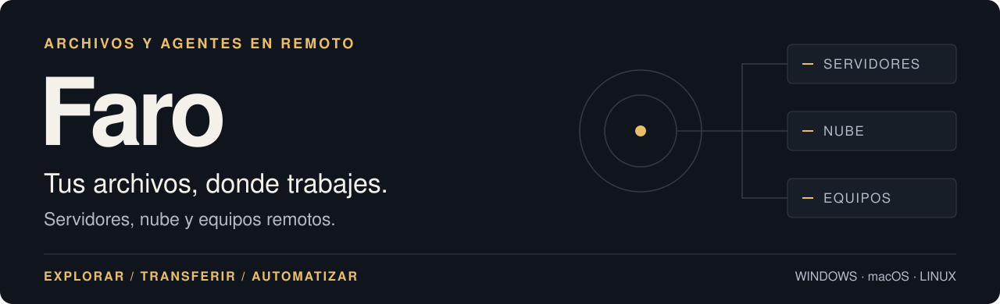
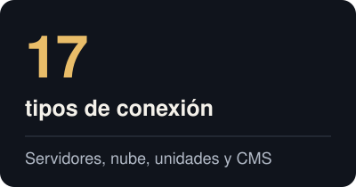
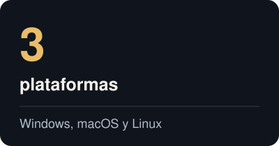
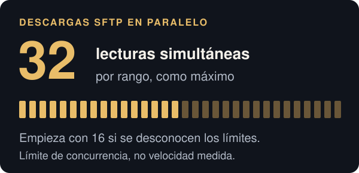
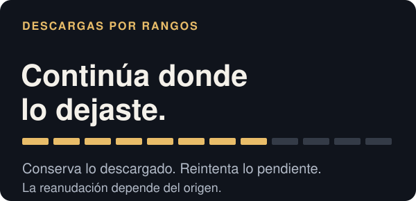
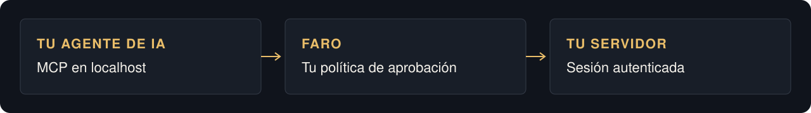

<p align="center">
  <picture>
    <source media="(max-width: 600px)" srcset="images/readme/es/hero-mobile.svg" />
    
  </picture>
</p>

<p align="center">
  <a href="https://github.com/jhd3197/faro/releases/latest"></a>
  <a href="https://github.com/jhd3197/faro/releases"></a>
  <a href="../LICENSE"></a>
  <a href="https://discord.gg/ZKk6tkCQfG"></a>
</p>

<p align="center"><a href="https://github.com/jhd3197/faro/releases/latest">Descargar Faro</a> · <a href="https://www.youtube.com/watch?v=nL9r3c9-5Kc">Ver la demo</a> · <a href="#screenshots">Capturas</a> · <a href="#transfers">Transferencias</a> · <a href="#agent-bridge">Agent Bridge</a> · <a href="#develop">Compilar</a></p>

<p align="center"><a href="../README.md">English</a> · Español · <a href="README.zh-CN.md">中文版</a> · <a href="README.pt.md">Português</a></p>

**Faro es un cliente de archivos de escritorio para Windows, macOS y Linux.** Conecta un servidor o una cuenta en la nube, explora archivos en dos paneles y transfiere carpetas entre ellos. Abre una terminal SSH en el mismo espacio de trabajo, edita archivos remotos con tu editor o da acceso a un agente local de IA mediante Agent Bridge.

<p align="center">
  <a href="#backends"></a>
  <a href="#quick-start"></a>
  <a href="#cli"></a>
</p>

<a name="quick-start"></a>
<a name="-inicio-rápido"></a>
## Inicio rápido

Elige un instalador de la [última versión](https://github.com/jhd3197/faro/releases/latest).

| Plataforma | Descargas |
|---|---|
| **Windows · x64** | Instalador `.exe`, `.msi` o `.zip` portátil |
| **macOS · Intel + Apple Silicon** | `.dmg` universal |
| **Linux · x64** | `.AppImage`, `.deb` o `.rpm` |

Abre **New Connection**, elige el tipo de conexión e introduce sus datos. También puedes importar perfiles de `~/.ssh/config`, FileZilla o PuTTY.

<details>
<summary><strong>Primer inicio: compilaciones sin firma en Windows y macOS</strong></summary>

Las compilaciones de Faro aún no cuentan con notarización de Apple ni certificado de firma de código de Windows.

- **Windows:** en «Windows protegió su PC», selecciona **Más información → Ejecutar de todas formas**.
- **macOS:** arrastra Faro a Aplicaciones y ejecuta lo siguiente una vez si macOS indica que está dañado:

  ```bash
  xattr -cr /Applications/Faro.app
  ```

- **AppImage en Linux:** da permiso de ejecución al archivo con `chmod +x <archivo>.AppImage`.

</details>

<!-- FARO:SHOTS:START -->
<a name="screenshots"></a>
<a name="-capturas-de-pantalla"></a>
## Capturas de pantalla

### Tus archivos locales y remotos, lado a lado

Mantén tus servidores en la barra de conexiones, arrastra archivos entre paneles y guarda las carpetas que usas como accesos a sitios.


<sub>Las capturas usan datos ficticios, incluidos nombres de servidor, rutas y velocidades. La interfaz de las capturas está en inglés. [Reproducir las capturas (en inglés)](screenshots/CAPTURE.md).</sub>

| Abre una terminal donde trabajas | Descubre qué ocupa espacio |
|---|---|
|  |  |
| Usa una shell SSH junto al navegador de archivos. | Explora carpetas con un mapa de bloques y una lista ordenada por tamaño. |

<details>
<summary><strong>Más vistas: transferencias, sincronización, nube y ajustes</strong></summary>

| Cola de transferencias | Sincronización de directorios |
|---|---|
|  |  |

| Almacenamiento de objetos | Barra de conexiones |
|---|---|
|  |  |

| Agent Bridge | Aprobación de comandos |
|---|---|
|  |  |

| Nueva conexión | Ajustes |
|---|---|
|  |  |


</details>
<!-- FARO:SHOTS:END -->

<a name="features"></a>
<a name="-funcionalidades"></a>
## Funcionalidades

| Archivos y conexiones | Herramientas de trabajo |
|---|---|
| **Explora y transfiere.** Dos paneles, arrastrar y soltar, carpetas recursivas y opciones para sobrescribir, omitir o renombrar. | **Edita archivos remotos.** Ábrelos en tu editor local y sube los cambios al guardar. |
| **Sincroniza carpetas.** Previsualiza un plan aditivo o espejo entre dos ubicaciones. Configura sincronización continua de local a remoto con exclusiones. | **Compara y busca.** Compara directorios entre servidores, verifica hashes o busca por nombre y contenido. |
| **Guarda ubicaciones.** Agrupa conexiones y guarda carpetas como sitios, con las credenciales y permisos de la conexión principal. | **Usa el teclado.** Accede a la paleta de comandos, las rutas de navegación, los filtros y las columnas ordenables. |
| **Conecta servicios.** Trabaja con servidores SSH, almacenamiento de objetos, unidades en la nube y API de CMS desde una misma lista. | **Automatiza tus servidores.** Ejecuta flujos de shell guardados en varios servidores con Fleet Skills, la CLI o herramientas MCP. |

<a name="transfers"></a>
## Transferencias

Pon subidas y descargas en cola, pausa tareas, reintenta fallos y limita el ancho de banda. Faro usa lecturas SFTP en paralelo y divide las descargas en rangos cuando el origen lo admite.

<p align="center">
  
  
</p>

| Durante una transferencia | Comportamiento de Faro |
|---|---|
| **Descargas grandes** | Divide los orígenes compatibles en rangos y ajusta la concurrencia durante la transferencia. |
| **Descargas interrumpidas** | Conserva los datos parciales y la información para reanudar. Los orígenes sin acceso por posición reinician desde el principio. |
| **Subida de carpetas** | Hace un inventario antes de poner archivos en cola, comprueba sus tamaños remotos e informa de fallos parciales. |
| **Verificación** | Ofrece verificación por checksum donde se admite, además de comprobar el tamaño de las subidas. |

Las tarjetas describen el funcionamiento del motor, no velocidades medidas. Este repositorio aún no publica una comparación reproducible con otros clientes. Las [pruebas de transferencias con servidores reales](../src-tauri/src/transfer/live_tests.rs) comprueban rendimiento e integridad contra servidores de prueba configurados; el [código del pipeline](../src-tauri/src/transfer/sources.rs) define los límites SFTP.

<a name="backends"></a>
## Tipos de conexión

Usa el mismo navegador de archivos con **17 tipos de conexión**. Las acciones disponibles dependen de cada servicio: un bucket no tiene shell, HTTP es de solo lectura y los CMS exponen los recursos que admiten.

| Categoría | Servicios compatibles |
|---|---|
| **Servidores** | SFTP, FTP y FTPS explícito |
| **Almacenamiento de objetos** | Almacenamiento compatible con S3, Azure Blob y Google Cloud Storage |
| **Almacenamiento web** | WebDAV, incluidos Nextcloud y ownCloud; índices HTTP(S) de solo lectura y URL directas |
| **Unidades en la nube** | Dropbox, OneDrive, Google Drive y Box |
| **Tiendas y CMS** | Temas de Shopify; Design Manager, archivos y exportaciones HubDB de solo lectura de HubSpot; recursos web de Dynamics 365 / Dataverse; medios y recursos REST de WordPress |
| **Equipos remotos** | Faro Agent en Windows, macOS y Linux |

Los perfiles S3 incluyen AWS, Cloudflare R2, Backblaze B2, Wasabi, DigitalOcean Spaces, MinIO, Storj, Hetzner, Scaleway, Oracle OCI, IBM COS y Supabase, además de endpoints S3 genéricos. Las unidades en la nube usan OAuth en el navegador y guardan los tokens de actualización en el llavero del sistema operativo.

<a name="agent-bridge"></a>
<a name="-agent-bridge"></a>
## Agent Bridge

**Permite que un agente local de IA use las sesiones de servidor que ya abriste en Faro.** Conecta Claude Code u otro cliente MCP mediante un endpoint en localhost. Elige las sesiones accesibles y revisa los comandos en Faro sin entregar al agente las credenciales del servidor.

<picture>
  <source media="(max-width: 600px)" srcset="images/readme/es/bridge-mobile.svg" />
  
</picture>

1. Conecta un servidor. Abre **Bridge**, selecciona **Start** y activa **Allow agent access** para esa sesión.
2. Copia el comando que genera el panel. Para Claude Code, tiene este formato:

   ```bash
   claude mcp add --transport http faro http://127.0.0.1:<port>/mcp \
     --header "Authorization: Bearer <token>"
   ```

3. Pide al agente que inspeccione el servidor. Faro ofrece herramientas para sesiones, comandos, archivos, búsquedas y flujos de trabajo. Las aprobaciones y la actividad aparecen en el panel Bridge.

El puente escucha en `127.0.0.1`, requiere un token bearer por ejecución y limita el acceso a las sesiones que habilites. Los comandos requieren aprobación por defecto; puedes configurar las políticas de aprobación. El panel registra comandos, aprobaciones y rechazos, y exporta un `SKILL.md` para agentes que usan la API HTTP.

## Faro Agent

Explora archivos y ejecuta comandos nativos en otro equipo Windows, macOS o Linux sin configurar SSH. En el equipo que quieres controlar, abre **Settings → Remote control**, actívalo y muestra el código de emparejamiento. Añade una conexión **Faro Agent** desde el otro equipo e introduce el código de seis dígitos.

Para un equipo Linux o macOS sin interfaz gráfica, usa el instalador del agente:

```bash
curl -fsSL https://github.com/jhd3197/Faro/releases/latest/download/install-agentd.sh | sh
```

<details>
<summary><strong>Comandos del daemon y seguridad de la conexión</strong></summary>

```bash
faro-agentd pair                 # servir y abrir una ventana de emparejamiento
faro-agentd run                  # atender a los controladores emparejados
faro-agentd install              # instalar como servicio
faro-agentd install --read-only  # restringir el servicio a operaciones de lectura
faro-agentd info                 # mostrar identidad y controladores emparejados
```

El agente usa un handshake Noise con X25519 y ChaCha20-Poly1305, emparejamiento por código y claves fijadas para cada par. El equipo controlado aplica su propia política de acceso y mantiene su registro de auditoría. El descubrimiento usa mDNS en la red local; el encuentro entre equipos y los relays por internet siguen previstos. Consulta la [guía del agente remoto (en inglés)](remote-agent.md).

</details>

## CLI

Usa los mismos perfiles guardados desde la terminal. Descarga `faro-cli` desde la [página de versiones](https://github.com/jhd3197/faro/releases/latest).

```bash
faro-cli profiles list
faro-cli ls prod:/var/log
faro-cli cp ./report.pdf prod:/var/www/uploads
faro-cli sync ./site prod:/var/www/site --mirror --dry-run
faro-cli diff prod:/etc staging:/etc --hash
faro-cli search prod:/var/log "OutOfMemory" --content --regex
faro-cli agent exec prod 'journalctl -u api -n 100'
```

Usa `nombre:/ruta` para una conexión guardada y una ruta normal para un archivo local. La CLI también admite operaciones de archivos, comandos de shell, trabajos de Bridge, Fleet Skills, peticiones HTTP autenticadas y actualizaciones propias. Consulta [más ejemplos e instrucciones de compilación (en inglés)](development.md#cli).

<a name="develop"></a>
<a name="desarrollar"></a>
## Desarrollo

Instala Node 20+, Rust 1.88+ y las dependencias de tu plataforma que indica la [guía de desarrollo (en inglés)](development.md). Después ejecuta:

```bash
npm install
npm run tauri dev
```

<a name="-arquitectura"></a>
Faro usa **Tauri 2, Rust, React y TypeScript**. La aplicación y la CLI comparten el núcleo Rust y la interfaz `RemoteFs`. Consulta la [arquitectura, estructura del proyecto y notas para Windows (en inglés)](development.md).

<a name="-documentación"></a>
## Documentación

Estas guías técnicas están en inglés.

| Guía | Contenido |
|---|---|
| [Desarrollo](development.md) | Arquitectura, compilación, CLI e imágenes del README |
| [Agente remoto](remote-agent.md) | Emparejamiento, protocolo y seguridad |
| [Enlaces directos](deep-links.md) | Conexiones mediante `faro://` |
| [Configuración de HubSpot](hubspot-private-app.md) | Configuración de una aplicación privada |
| [Capturas](screenshots/CAPTURE.md) | Captura con datos ficticios y reproducción |
| [Custodia de claves del actualizador](updater-key-custody.md) | Gestión de las claves de firma |

<a name="-hoja-de-ruta"></a>
## Hoja de ruta

El trabajo previsto incluye SMB/CIFS, sincronización bidireccional con resolución de conflictos, carpetas virtuales bajo demanda, conexión de Faro Agent por internet y firma de código de escritorio. Consulta las [versiones](https://github.com/jhd3197/faro/releases) para ver cambios publicados y las [incidencias](https://github.com/jhd3197/faro/issues) para debatir propuestas.

<a name="-contribuir"></a>
## Contribuir

Son bienvenidas las contribuciones a tipos de conexión, fiabilidad de transferencias, interfaz, pruebas y documentación. [Abre una incidencia](https://github.com/jhd3197/faro/issues) para comentar un cambio grande o envía un pull request con una descripción y los pasos de verificación.

## Apoya Faro

Faro es gratuito y de código abierto. Puedes apoyar su desarrollo mediante [GitHub Sponsors](https://github.com/sponsors/jhd3197) o [Buy Me a Coffee](https://buymeacoffee.com/jhd3197), o [dar una estrella al repositorio](https://github.com/jhd3197/faro).

<details>
<summary><strong>Donaciones en criptomonedas</strong></summary>

| | Activo | Red | Dirección |
|:---:|---|---|---|
|  | **USDT** | **TRC-20** · Tron | `TTiCtqLauF1iSW2YGB3b78KmRxRqoLCgeL` |
|  | **USDT / ETH** | **ERC-20** · Ethereum | `0xD13D5355Fa214e8317fea2ff192a065BaeC13527` |
|  | **BTC** | **Bitcoin** | `bc1qatx67n3qxdvuv3arc9j8aytk34f22g02k9c7vr` |
|  | **SOL** | **Solana** | `AWXzqtBEgUfteHPQtDegsZ6D5y57M3GGdKPD8rR7h6xu` |

</details>

## Proyectos relacionados

- **[ServerKit](https://github.com/jhd3197/ServerKit):** gestiona aplicaciones web, bases de datos, contenedores Docker y seguridad del servidor desde el navegador.
- **[LocalKit](https://github.com/jhd3197/LocalKit):** ejecuta sitios WordPress locales con Docker Compose y conéctalos a ServerKit.
- **[DeviceKit](https://github.com/jhd3197/DeviceKit):** gestiona dispositivos Android, ejecuta automatizaciones y prueba aplicaciones en varios equipos.

<a name="-comunidad"></a>
## Comunidad

Únete a [Faro en Discord](https://discord.gg/ZKk6tkCQfG) para recibir ayuda, compartir comentarios y conversar. Informa de errores y solicita funciones en [GitHub Issues](https://github.com/jhd3197/faro/issues).

## Licencia

[MIT](../LICENSE). Creado por [Juan Denis](https://juandenis.com).
