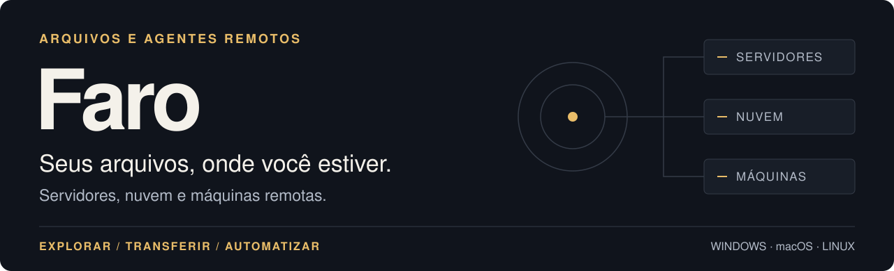
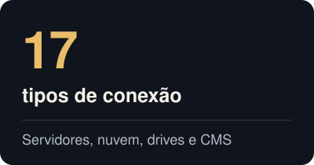
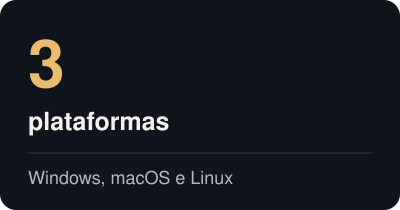
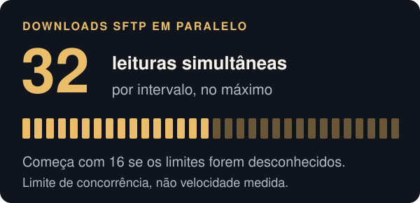
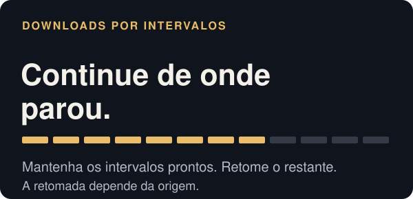

<p align="center">
  <picture>
    <source media="(max-width: 600px)" srcset="images/readme/pt/hero-mobile.svg" />
    
  </picture>
</p>

<p align="center">
  <a href="https://github.com/jhd3197/faro/releases/latest"></a>
  <a href="https://github.com/jhd3197/faro/releases"></a>
  <a href="../LICENSE"></a>
  <a href="https://discord.gg/ZKk6tkCQfG"></a>
</p>

<p align="center"><a href="https://github.com/jhd3197/faro/releases/latest">Baixar Faro</a> · <a href="https://www.youtube.com/watch?v=nL9r3c9-5Kc">Ver a demonstração</a> · <a href="#screenshots">Capturas</a> · <a href="#transfers">Transferências</a> · <a href="#agent-bridge">Agent Bridge</a> · <a href="#develop">Compilar</a></p>

<p align="center"><a href="../README.md">English</a> · <a href="README.es.md">Español</a> · <a href="README.zh-CN.md">中文版</a> · Português</p>

**Faro é um cliente de arquivos para Windows, macOS e Linux.** Conecte um servidor ou uma conta na nuvem, navegue pelos arquivos em dois painéis e transfira pastas entre eles. Abra um terminal SSH no mesmo espaço de trabalho, edite arquivos remotos com seu editor ou dê acesso a um agente local de IA pelo Agent Bridge.

<p align="center">
  <a href="#backends"></a>
  <a href="#quick-start"></a>
  <a href="#cli"></a>
</p>

<a name="quick-start"></a>
<a name="-início-rápido"></a>
## Início rápido

Escolha um instalador da [versão mais recente](https://github.com/jhd3197/faro/releases/latest).

| Plataforma | Downloads |
|---|---|
| **Windows · x64** | Instalador `.exe`, `.msi` ou `.zip` portátil |
| **macOS · Intel + Apple Silicon** | `.dmg` universal |
| **Linux · x64** | `.AppImage`, `.deb` ou `.rpm` |

Abra **New Connection**, escolha o tipo de conexão e informe os dados de acesso. Você também pode importar perfis de `~/.ssh/config`, FileZilla ou PuTTY.

<details>
<summary><strong>Primeira execução: builds sem assinatura no Windows e macOS</strong></summary>

Os builds do Faro ainda não têm notarização da Apple nem certificado de assinatura de código do Windows.

- **Windows:** no aviso «O Windows protegeu o seu PC», selecione **Mais informações → Executar mesmo assim**.
- **macOS:** arraste o Faro para Aplicativos e execute o comando abaixo uma vez se o macOS informar que o app está danificado:

  ```bash
  xattr -cr /Applications/Faro.app
  ```

- **AppImage no Linux:** dê permissão de execução ao arquivo com `chmod +x <arquivo>.AppImage`.

</details>

<!-- FARO:SHOTS:START -->
<a name="screenshots"></a>
<a name="-capturas-de-tela"></a>
## Capturas de tela

### Seus arquivos locais e remotos, lado a lado

Mantenha seus servidores na barra de conexões, arraste arquivos entre painéis e salve pastas frequentes como atalhos de sites.


<sub>As capturas usam dados fictícios, incluindo nomes de servidores, caminhos e velocidades. A interface das capturas está em inglês. [Reproduzir as capturas (em inglês)](screenshots/CAPTURE.md).</sub>

| Abra um terminal onde trabalha | Veja o que ocupa espaço |
|---|---|
|  |  |
| Use um shell SSH ao lado do navegador de arquivos. | Explore pastas com um mapa de blocos e uma lista ordenada por tamanho. |

<details>
<summary><strong>Mais telas: transferências, sincronização, nuvem e configurações</strong></summary>

| Fila de transferências | Sincronização de diretórios |
|---|---|
|  |  |

| Armazenamento de objetos | Barra de conexões |
|---|---|
|  |  |

| Agent Bridge | Aprovação de comandos |
|---|---|
|  |  |

| Nova conexão | Configurações |
|---|---|
|  |  |


</details>
<!-- FARO:SHOTS:END -->

<a name="features"></a>
<a name="-funcionalidades"></a>
## Funcionalidades

| Arquivos e conexões | Ferramentas de trabalho |
|---|---|
| **Explore e transfira.** Dois painéis, arrastar e soltar, pastas recursivas e opções para sobrescrever, ignorar ou renomear. | **Edite arquivos remotos.** Abra no seu editor local e envie as alterações ao salvar. |
| **Sincronize pastas.** Confira um plano aditivo ou espelhado entre dois locais. Configure sincronização contínua de local para remoto com exclusões. | **Compare e pesquise.** Compare diretórios entre servidores, verifique hashes ou pesquise por nome e conteúdo. |
| **Salve locais.** Agrupe conexões e salve pastas como sites, usando as credenciais e permissões da conexão principal. | **Use o teclado.** Acesse a paleta de comandos, os caminhos de navegação, os filtros e as colunas ordenáveis. |
| **Conecte serviços.** Trabalhe com servidores SSH, armazenamento de objetos, drives na nuvem e APIs de CMS na mesma lista. | **Automatize seus servidores.** Execute fluxos de shell salvos em vários servidores com Fleet Skills, a CLI ou ferramentas MCP. |

<a name="transfers"></a>
## Transferências

Coloque uploads e downloads na fila, pause tarefas, repita operações que falharam e limite a largura de banda. O Faro usa leituras SFTP em paralelo e divide downloads em intervalos nas origens compatíveis.

<p align="center">
  
  
</p>

| Durante uma transferência | Comportamento do Faro |
|---|---|
| **Downloads grandes** | Divide origens compatíveis em intervalos e ajusta a concorrência durante a transferência. |
| **Downloads interrompidos** | Mantém os dados parciais e as informações de retomada. Origens sem acesso por posição reiniciam do começo. |
| **Upload de pastas** | Faz um inventário antes de colocar os arquivos na fila, confere os tamanhos remotos e informa falhas parciais. |
| **Verificação** | Oferece verificação por checksum onde há suporte, além de conferir o tamanho dos uploads. |

Os cartões descrevem o funcionamento do motor, não velocidades medidas. Este repositório ainda não publica uma comparação reproduzível com outros clientes. Os [testes de transferências com servidores reais](../src-tauri/src/transfer/live_tests.rs) verificam desempenho e integridade em servidores de teste configurados; o [código do pipeline](../src-tauri/src/transfer/sources.rs) define os limites SFTP.

<a name="backends"></a>
## Tipos de conexão

Use o mesmo navegador de arquivos com **17 tipos de conexão**. As ações disponíveis dependem de cada serviço: um bucket não tem shell, HTTP é somente leitura e os CMS expõem os recursos compatíveis.

| Categoria | Serviços compatíveis |
|---|---|
| **Servidores** | SFTP, FTP e FTPS explícito |
| **Armazenamento de objetos** | Armazenamento compatível com S3, Azure Blob e Google Cloud Storage |
| **Armazenamento web** | WebDAV, incluindo Nextcloud e ownCloud; índices HTTP(S) somente leitura e URLs diretas |
| **Drives na nuvem** | Dropbox, OneDrive, Google Drive e Box |
| **Lojas e CMS** | Temas do Shopify; Design Manager, arquivos e exportações HubDB somente leitura do HubSpot; recursos web do Dynamics 365 / Dataverse; mídia e recursos REST do WordPress |
| **Máquinas remotas** | Faro Agent no Windows, macOS e Linux |

Os perfis S3 incluem AWS, Cloudflare R2, Backblaze B2, Wasabi, DigitalOcean Spaces, MinIO, Storj, Hetzner, Scaleway, Oracle OCI, IBM COS e Supabase, além de endpoints S3 genéricos. Os drives na nuvem usam OAuth pelo navegador e armazenam os tokens de atualização no chaveiro do sistema operacional.

<a name="agent-bridge"></a>
<a name="-agent-bridge"></a>
## Agent Bridge

**Permita que um agente local de IA use as sessões de servidor que você já abriu no Faro.** Conecte o Claude Code ou outro cliente MCP por um endpoint em localhost. Escolha as sessões acessíveis e revise os comandos no Faro sem entregar as credenciais do servidor ao agente.

<picture>
  <source media="(max-width: 600px)" srcset="images/readme/pt/bridge-mobile.svg" />
  
</picture>

1. Conecte um servidor. Abra **Bridge**, selecione **Start** e ative **Allow agent access** para a sessão.
2. Copie o comando gerado pelo painel. Para o Claude Code, ele tem este formato:

   ```bash
   claude mcp add --transport http faro http://127.0.0.1:<port>/mcp \
     --header "Authorization: Bearer <token>"
   ```

3. Peça ao agente para inspecionar o servidor. O Faro oferece ferramentas para sessões, comandos, arquivos, pesquisas e fluxos de trabalho. As aprovações e a atividade aparecem no painel Bridge.

A ponte escuta em `127.0.0.1`, exige um token bearer por execução e limita o acesso às sessões que você habilita. Os comandos exigem aprovação por padrão; você pode configurar as políticas de aprovação. O painel registra comandos, aprovações e recusas, e exporta um `SKILL.md` para agentes que usam a API HTTP.

## Faro Agent

Explore arquivos e execute comandos nativos em outro computador Windows, macOS ou Linux sem configurar SSH. Na máquina que deseja controlar, abra **Settings → Remote control**, ative a função e mostre o código de pareamento. Adicione uma conexão **Faro Agent** na outra máquina e informe o código de seis dígitos.

Para uma máquina Linux ou macOS sem interface gráfica, use o instalador do agente:

```bash
curl -fsSL https://github.com/jhd3197/Faro/releases/latest/download/install-agentd.sh | sh
```

<details>
<summary><strong>Comandos do daemon e segurança da conexão</strong></summary>

```bash
faro-agentd pair                 # atender conexões e abrir uma janela de pareamento
faro-agentd run                  # atender aos controladores pareados
faro-agentd install              # instalar como serviço
faro-agentd install --read-only  # restringir o serviço a operações de leitura
faro-agentd info                 # mostrar identidade e controladores pareados
```

O agente usa um handshake Noise com X25519 e ChaCha20-Poly1305, pareamento por código e chaves fixadas para cada par. A máquina controlada aplica sua própria política de acesso e mantém seu registro de auditoria. A descoberta usa mDNS na rede local; o encontro entre máquinas e os relays pela internet continuam planejados. Veja o [guia do agente remoto (em inglês)](remote-agent.md).

</details>

## CLI

Use os mesmos perfis salvos pelo terminal. Baixe o `faro-cli` na [página de versões](https://github.com/jhd3197/faro/releases/latest).

```bash
faro-cli profiles list
faro-cli ls prod:/var/log
faro-cli cp ./report.pdf prod:/var/www/uploads
faro-cli sync ./site prod:/var/www/site --mirror --dry-run
faro-cli diff prod:/etc staging:/etc --hash
faro-cli search prod:/var/log "OutOfMemory" --content --regex
faro-cli agent exec prod 'journalctl -u api -n 100'
```

Use `nome:/caminho` para uma conexão salva e um caminho comum para um arquivo local. A CLI também oferece operações de arquivos, comandos de shell, tarefas do Bridge, Fleet Skills, requisições HTTP autenticadas e atualização própria. Veja [mais exemplos e instruções de compilação (em inglês)](development.md#cli).

<a name="develop"></a>
<a name="desenvolver"></a>
## Desenvolvimento

Instale Node 20+, Rust 1.88+ e as dependências da sua plataforma indicadas no [guia de desenvolvimento (em inglês)](development.md). Depois execute:

```bash
npm install
npm run tauri dev
```

<a name="-arquitetura"></a>
O Faro usa **Tauri 2, Rust, React e TypeScript**. O aplicativo e a CLI compartilham o núcleo Rust e a interface `RemoteFs`. Consulte a [arquitetura, estrutura do projeto e notas para Windows (em inglês)](development.md).

<a name="-documentação"></a>
## Documentação

Estes guias técnicos estão em inglês.

| Guia | Conteúdo |
|---|---|
| [Desenvolvimento](development.md) | Arquitetura, compilação, CLI e imagens do README |
| [Agente remoto](remote-agent.md) | Pareamento, protocolo e segurança |
| [Links diretos](deep-links.md) | Conexões por `faro://` |
| [Configuração do HubSpot](hubspot-private-app.md) | Configuração de um aplicativo privado |
| [Capturas](screenshots/CAPTURE.md) | Captura com dados fictícios e reprodução |
| [Custódia das chaves do atualizador](updater-key-custody.md) | Gerenciamento das chaves de assinatura |

<a name="-roadmap"></a>
## Roadmap

O trabalho planejado inclui SMB/CIFS, sincronização bidirecional com resolução de conflitos, pastas virtuais sob demanda, acesso ao Faro Agent pela internet e assinatura de código para desktop. Consulte as [versões](https://github.com/jhd3197/faro/releases) para ver alterações publicadas e as [issues](https://github.com/jhd3197/faro/issues) para discutir propostas.

<a name="-contribuindo"></a>
## Contribuindo

Contribuições para tipos de conexão, confiabilidade das transferências, interface, testes e documentação são bem-vindas. [Abra uma issue](https://github.com/jhd3197/faro/issues) para discutir uma mudança maior ou envie um pull request com uma descrição e os passos de verificação.

## Apoie o Faro

O Faro é gratuito e de código aberto. Apoie o desenvolvimento pelo [GitHub Sponsors](https://github.com/sponsors/jhd3197) ou [Buy Me a Coffee](https://buymeacoffee.com/jhd3197), ou [dê uma estrela ao repositório](https://github.com/jhd3197/faro).

<details>
<summary><strong>Doações em criptomoedas</strong></summary>

| | Ativo | Rede | Endereço |
|:---:|---|---|---|
|  | **USDT** | **TRC-20** · Tron | `TTiCtqLauF1iSW2YGB3b78KmRxRqoLCgeL` |
|  | **USDT / ETH** | **ERC-20** · Ethereum | `0xD13D5355Fa214e8317fea2ff192a065BaeC13527` |
|  | **BTC** | **Bitcoin** | `bc1qatx67n3qxdvuv3arc9j8aytk34f22g02k9c7vr` |
|  | **SOL** | **Solana** | `AWXzqtBEgUfteHPQtDegsZ6D5y57M3GGdKPD8rR7h6xu` |

</details>

## Projetos relacionados

- **[ServerKit](https://github.com/jhd3197/ServerKit):** gerencie aplicativos web, bancos de dados, contêineres Docker e segurança do servidor pelo navegador.
- **[LocalKit](https://github.com/jhd3197/LocalKit):** execute sites WordPress locais com Docker Compose e conecte-os ao ServerKit.
- **[DeviceKit](https://github.com/jhd3197/DeviceKit):** gerencie dispositivos Android, execute automações e teste aplicativos em vários aparelhos.

<a name="-comunidade"></a>
## Comunidade

Entre no [Faro no Discord](https://discord.gg/ZKk6tkCQfG) para receber ajuda, compartilhar comentários e conversar. Relate bugs e solicite funcionalidades nas [issues do GitHub](https://github.com/jhd3197/faro/issues).

## Licença

[MIT](../LICENSE). Criado por [Juan Denis](https://juandenis.com).
